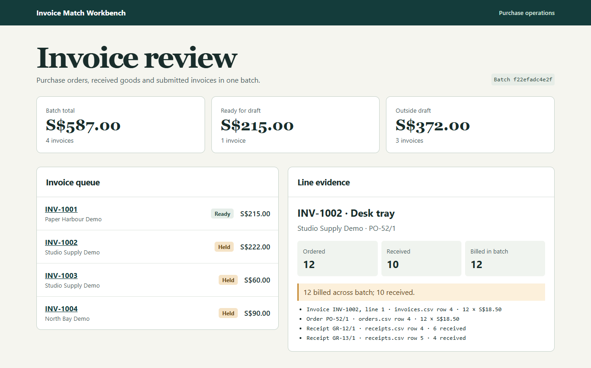

# Invoice Match Workbench

Compare supplier invoices with purchase orders and goods receipts before preparing an accounting draft. An operations reviewer can trace each exception to its source CSV row, record a decision and regenerate the draft locally.

The [v0.1.1 release](https://github.com/dextee/invoice-match-workbench/releases/tag/v0.1.1) includes the generated HTML report, its matching JSON draft and a second report tracing duplicate billing.

**Need this for your finance team?** Tell VYR where invoices arrive, which accounting system you use and who approves exceptions. We can scope an AI agent around those handoffs. [Discuss your invoice workflow](https://vyrwork.com/contact?utm_source=github&utm_medium=referral&utm_campaign=github_profile&utm_content=invoice_workbench_enquiry)



## Run the example

For a timed first visit, use the [five-minute exercise](docs/first-run.md) to trace a held invoice and record where setup or interpretation slows you down.

With Python 3.11 or later, open a terminal in this checkout and run:

```sh
python workbench.py demo
```

On Windows, `py` can replace `python`. The command works offline using Python's standard library. Open the printed **report.html** path in a browser. The adjacent **draft.json** contains eligible invoice lines in SGD cents. Every supplier, document and value in the example is synthetic.

To open the report in your default browser as part of the same command, run `python workbench.py demo --open-report`.

| Invoice | Submitted | Initial result | Evidence |
| --- | ---: | --- | --- |
| INV-1001 | S$215.00 | Ready | Both lines agree with their orders and receipts. |
| INV-1002 | S$222.00 | Held | The invoice bills 12 desk trays. Two receipts record 6 and 4. |
| INV-1003 | S$60.00 | Held | Four sleeves are billed at S$15 each. The order specifies S$14. |
| INV-1004 | S$90.00 | Held | The order exists. The batch contains no receipt for its clips. |

The initial draft contains S$215.00. The other three invoices account for S$372.00, giving a submitted total of S$587.00. The report links the desk-tray exception to [invoice row 4](examples/demo/invoices.csv#L4), [order row 4](examples/demo/orders.csv#L4) and [receipt rows 4 and 5](examples/demo/receipts.csv#L4-L5).

### Trace two bills against one delivery

Four desk mats arrive. Two different invoice numbers each claim all four mats at S$15 each. Run the [synthetic duplicate-billing example](examples/duplicate-billing) and open **Invoices sharing a quantity hold** to follow the two source rows.

```sh
python workbench.py demo --input examples/duplicate-billing --open-report
```

INV-2001 and INV-2002 stay out of the draft pending review. The source rows show eight mats billed against four ordered and received. Two more invoices split a two-folder delivery into one folder each, so both qualify. The draft contains **S$20 of S$140**. [Open the generated example from the release](https://github.com/dextee/invoice-match-workbench/releases/download/v0.1.1/duplicate-billing-report.html)

## Resolve exceptions

These commands act on the sample workspace. Each accepted command refreshes the HTML report and JSON draft.

```sh
python workbench.py review --invoice INV-1002 --decision defer --reviewer "Demo reviewer" --reason "Wait for the two outstanding trays."
python workbench.py review --invoice INV-1003 --decision accept-price --reviewer "Demo reviewer" --reason "The sample supplier amendment approves the one-dollar variance."
python workbench.py review --invoice INV-1004 --decision reject --reviewer "Demo reviewer" --reason "The sample supplier confirms this delivery was cancelled."
python workbench.py export
```

The resulting draft contains INV-1001 and INV-1003, worth **S$275.00** together. Price acceptance requires price differences to be the only exceptions on the entire invoice. A receipt shortage stays outside the draft until corrected source records arrive in a new batch. Select `reopen` with a reviewer and reason to restore the rules-based result. Earlier decisions remain in the local SQLite history.

## Use your own synthetic batch

Copy the [three CSV files](examples/demo) into a folder such as `my-batch` and retain the headers. Then run:

```sh
python workbench.py import --input my-batch --workspace my-reviews
python workbench.py export --input my-batch --workspace my-reviews
```

Use the same `--input` and `--workspace` on a review command. The workspace stores one batch per combination of source-file hashes and matching-rule version, all reviewer decisions, and one output directory per batch. Reimporting the same bytes preserves decisions. Re-exporting without a state change produces byte-identical files. Changing a CSV, including its line endings, creates a fresh batch. Reviewers must evaluate that snapshot independently.

| File | Identity | Requirements |
| --- | --- | --- |
| orders.csv | Order-line ID | Supplier, item description, ordered quantity and agreed SGD unit rate. |
| receipts.csv | Receipt-line ID | Each receipt references an existing order line. Multiple deliveries may fulfil one order line. |
| invoices.csv | Invoice ID plus line ID | Each invoice belongs to one supplier. Include the order-line ID, supplier, item, quantity, unit rate and submitted line total. |

The matcher compares item and supplier text exactly after trimming outside whitespace. It sums all billed quantities against each order line to catch overbilling across invoices in the same batch. Any exception holds the entire invoice. Invalid file structure, duplicate row identities and malformed amounts stop the import. Amounts use integer cents, and quantities are positive whole units.

## Scope

The workbench creates review drafts. People retain payment and posting authority. The sample covers goods purchased in one currency. Credit notes, taxes, OCR, currency conversion, historic bills outside the supplied batch and accounting-system integrations need separate handling. Reviewer identity is a local, self-declared label. The local database can be edited by its owner.

A team can use the demo to examine three-way matching before deciding how its own finance process should handle exceptions. [ERPNext's buying controls](https://docs.frappe.io/erpnext/buying-settings) provide an example of order, receipt and unit-rate checks within an ERP.

## Verify the release

```sh
python -m unittest discover -s tests -v
```

The tests cover fixture totals, source rows, duplicate billing across invoices, legitimate split billing, report launch, malformed imports, repeat and concurrent runs, decision persistence, scoped approvals, changed inputs and escaped report text.
